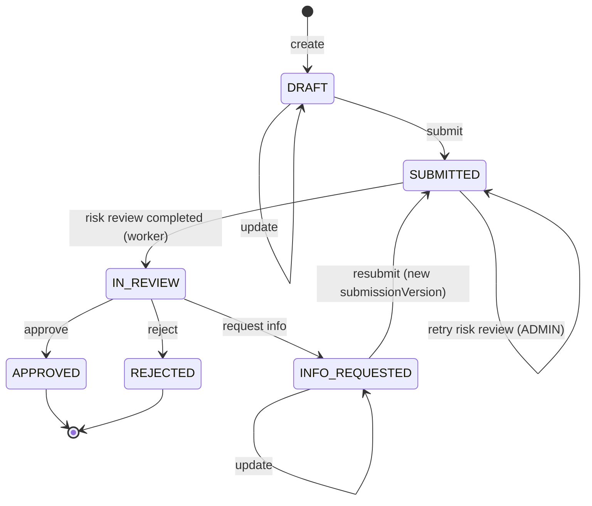

# Merchant Onboarding Backend

A NestJS service for onboarding merchants onto a payments platform. Sales staff create merchant applications. Submitting one triggers an **asynchronous risk / KYB review** (BullMQ). An admin assigns a reviewer, and **only that reviewer** can approve, reject or request more information. Every significant action is **audited**, and sensitive fields are masked or redacted wherever they could leak.

**Stack:** TypeScript · NestJS 11 · PostgreSQL 16 + TypeORM (reviewed migrations) · Redis 7 + BullMQ 6 · JWT · OpenAPI/Swagger · Jest + Supertest · Docker Compose

- [Quick start](#quick-start)
- [Configuration](#configuration)
- [API](#api)
- [Application lifecycle](#application-lifecycle)
- [Authorization model](#authorization-model)
- [Asynchronous risk review](#asynchronous-risk-review)
- [Audit trail and sensitive data](#audit-trail-and-sensitive-data)
- [Testing](#testing)
- [Project structure](#project-structure)
- [Assumptions and interpretations](#assumptions-and-interpretations)
- [Trade-offs and what I'd do with more time](#trade-offs-and-what-id-do-with-more-time)
- [AI usage disclosure](#ai-usage-disclosure)

Design decisions are recorded as ADRs in [`docs/adr/`](docs/adr/README.md). Security and the field-level encryption plan are in [`docs/security.md`](docs/security.md).

---

## Quick start

Requirements: Docker. Node 20+ only if you run the app outside Docker.

```bash
cp .env.example .env
# Replace every "change-me" value. JWT_SECRET needs at least 32 characters:
#   openssl rand -base64 48
```

### Option A: everything in Docker

```bash
docker compose up -d --build
```

On every start, the `api` container runs the migrations, then the seed, then the app. The seed upserts the fake demo users, so each start also sets them back to active, with the role and the `SEED_USER_PASSWORD` from `.env`. Open **http://localhost:3000/docs** (Swagger). Health check: `GET /health`.

If port 3000 is already in use (for example by `npm run start:dev`), run `PORT=3001 docker compose up -d --build` and use port 3001 instead.

### Option B: run the app locally (hot reload)

```bash
docker compose up -d postgres redis   # Postgres on host port 5433, Redis on 6379
npm ci
npm run migration:run
npm run seed
npm run start:dev                     # http://localhost:3000/docs
```

### Demo users

All fake. The password is whatever you set as `SEED_USER_PASSWORD` in `.env`.

| Email | Role |
|---|---|
| `admin@example.com` | ADMIN |
| `reviewer@example.com`, `reviewer2@example.com` | REVIEWER |
| `sales@example.com`, `sales2@example.com` | SALES |

In Swagger, call `POST /auth/login`, copy the `accessToken`, and click **Authorize**.

## Configuration

Every variable is validated at startup, and the app refuses to start on missing or weak values.

| Variable | Default | Notes |
|---|---|---|
| `NODE_ENV` | `development` | `production` additionally rejects a placeholder `JWT_SECRET` |
| `PORT` | `3000` | |
| `LOG_LEVEL` | `info` | pino level; `silent` in tests |
| `DB_HOST` `DB_PORT` `DB_USER` `DB_PASSWORD` `DB_NAME` | n/a | Postgres. Host port **5433** in the local setup |
| `REDIS_HOST` `REDIS_PORT` | n/a | |
| `BULL_PREFIX` | `mo` | Redis key prefix; tests use `test` |
| `JWT_SECRET` | n/a | At least 32 characters |
| `JWT_EXPIRES_IN_SECONDS` | `900` | 60–86400 |
| `SEED_USER_PASSWORD` | n/a | Password for the demo users. The seed script refuses values shorter than 12 characters, which also stops the Docker `api` container from starting |
| `RISK_JOB_ATTEMPTS` | `5` | Total attempts per risk-review job, first try included (5 = 1 try + 4 retries) |
| `RISK_JOB_BACKOFF_MS` | `2000` | Base delay for exponential backoff |
| `RISK_SIM_LATENCY_MS` | `300` | Simulated KYB provider latency |
| `RISK_SIM_FAILURE_RATE` | `0.2` | Share of simulated transient failures (shows off the retries); `0` in tests |

## API

The full schema is in Swagger at `/docs`. Errors share one shape: `{ statusCode, error, message, path, timestamp, requestId }`.

| Method | Path | Who | What |
|---|---|---|---|
| `POST` | `/auth/login` | public | Returns a 15-minute bearer token |
| `GET` | `/health` | public | Checks Postgres and Redis (503 names whatever is down) |
| `POST` | `/applications` | ADMIN, SALES | Create a `DRAFT` |
| `GET` | `/applications` | all roles | List, scoped to the caller. `?status=&page=&limit=` (max 100) |
| `GET` | `/applications/:id` | all roles | Scoped. Not visible means **404** |
| `PATCH` | `/applications/:id` | ADMIN, SALES (own) | Only in `DRAFT` / `INFO_REQUESTED`. **Requires `expectedVersion`** (409 if stale, [ADR 0008](docs/adr/0008-expected-version-on-update.md)) |
| `POST` | `/applications/:id/submit` | ADMIN, SALES (own) | → `SUBMITTED`, `riskStatus=PENDING`, queues the risk review |
| `POST` | `/applications/:id/assign` | ADMIN | `{ reviewerId, expectedVersion }`. The reviewer must be an active REVIEWER; a stale version is a 409 |
| `POST` | `/applications/:id/decision` | **assigned** REVIEWER | `{ decision: APPROVE \| REJECT \| REQUEST_INFO, reason }` |
| `POST` | `/applications/:id/risk-review/retry` | ADMIN | Recovers a `FAILED` or stuck `PENDING` review ([ADR 0009](docs/adr/0009-admin-risk-review-retry.md)) |

Status codes:
- 400: validation failed, or the request contains unknown or server-owned fields.
- 401: missing or invalid token.
- 403: wrong role, or a REVIEWER who isn't assigned.
- 404: not found, or not visible to the caller.
- 409: invalid state transition or stale `expectedVersion`.
- 503: the change was saved, but the risk review couldn't be queued.

## Application lifecycle

All transitions live in one table, [`application-state-machine.ts`](src/modules/applications/domain/application-state-machine.ts). It's made of pure functions and unit tested against every status × action pair.



- **Assign** is allowed in `SUBMITTED` and `IN_REVIEW` and doesn't change the status.
- **Approve, reject and request-info** need the assigned reviewer and a `reason`.
- **`APPROVED` and `REJECTED` are terminal.**
- **Risk status** is `NOT_STARTED → PENDING → COMPLETED | FAILED`. Each submission gets its own `submissionVersion` and its own risk assessment.

## Authorization model

There are three layers, and every endpoint goes through all of them ([ADR 0002](docs/adr/0002-object-level-authorization.md)):

1. **Authentication:** a global JWT guard. Everything is protected unless it's `@Public()`. The user is reloaded on every request, so a deactivated user is locked out immediately and **the role comes from the database, not the token**.
2. **Role:** `@Roles(...)` per route, checked by a global guard.
3. **Object level:** every application query starts from one `scopedQuery()`, which puts the caller's scope into the SQL. Callers then add their own conditions with `andWhere`. TypeORM is configured with `isolateWhereStatements`, so every condition gets its own parentheses and a caller condition containing `OR` can't widen the scope. An e2e test checks exactly that ([ADR 0002](docs/adr/0002-object-level-authorization.md)).

| | ADMIN | REVIEWER | SALES |
|---|---|---|---|
| Create | ✅ | 403 | ✅ (`createdById` = token user) |
| Read / list | all | all except `DRAFT` | **own only** (others → 404) |
| Update / submit | ✅ | 403 | own only (others → 404) |
| Assign reviewer | ✅ | 403 | 403 |
| Record decision | 403 ([ADR 0003](docs/adr/0003-decision-and-assignment-rights.md)) | **only if assigned** (else 403) | 403 |
| Retry risk review | ✅ | 403 | 403 |

**404 vs 403:** if you aren't allowed to know an application exists, you get 404. If you can see it but can't act on it, you get 403.

The e2e suite [`authorization cannot be bypassed`](test/applications-authz.e2e-spec.ts) asserts the status code of every bypass attempt. Most write attempts also check that **the row is unchanged** (another user's update and submit, assign, decision, retry, and server-owned fields on update), and submit and retry check that **nothing was queued**. The REVIEWER 403s on create, update and submit, and the 400s for server-owned fields on create, check the status code only.

## Asynchronous risk review

```
submit ─TX: lock, SUBMITTED, submissionVersion+1, PENDING, audit─▶ commit ─▶ enqueue { applicationId, submissionVersion }
                                                                              jobId = risk-<id>-v<n>
worker ─▶ stale or duplicate? skip (no provider call) ─▶ KYB provider (outside any TX)
       ─▶ TX: lock, re-check, insert assessment, IN_REVIEW, audit (actor SYSTEM)
```

- **Enqueue after commit**, so the worker always sees the committed row. If Redis is down, submit returns **503 within milliseconds**: the producer has its own connection with `enableOfflineQueue: false`, so the request doesn't hang. The worker uses a separate connection that waits for Redis to come back ([ADR 0010](docs/adr/0010-risk-review-module-boundary.md)). The application stays `PENDING` until an ADMIN retries it ([ADR 0004](docs/adr/0004-async-risk-review-idempotency.md)).
- **Idempotency** has three layers:
  1. A deterministic `jobId`.
  2. Stale and duplicate checks, repeated under a row lock.
  3. A **unique constraint** on `risk_assessments(application_id, submission_version)`. A violation of that named constraint counts as success.

  Running the same job twice gives the same end state and exactly one assessment. This is tested for a re-run job and for two workers racing.
- **Retries:**
  - A transient provider error gets up to `RISK_JOB_ATTEMPTS` attempts in total (first try included), with exponential backoff starting at `RISK_JOB_BACKOFF_MS`.
  - The provider's `PermanentProviderError` is turned into BullMQ's `UnrecoverableError` by the processor and isn't retried.
  - After the last failed attempt, `riskStatus=FAILED` is set and audited, if the application is still waiting on that submission.
- **Recovery:** `POST /applications/:id/risk-review/retry` calls BullMQ's `job.retry()` for a failed job with a fresh retry budget, or adds the job if it was never queued. A plain `add()` with an existing jobId is silently ignored, which is why retry exists.
- **Simulated KYB provider** ([`modules/risk`](src/modules/risk/simulated-kyb.provider.ts)):
  - Deterministic scoring: the same business always gets the same score.
  - High-risk MCCs (for example `7995`, gambling) score **HIGH**.
  - MCC `0000` triggers a permanent rejection.
  - A configurable latency and transient-failure rate.

  It sits behind a `RiskProvider` interface, so a real vendor is a one-provider swap ([ADR 0010](docs/adr/0010-risk-review-module-boundary.md)).

## Audit trail and sensitive data

- **Audit rows** are written **in the same transaction** as the change, so an audit row exists if and only if the change committed. They're append-only. Each row stores the actor (user, `SYSTEM` or `ANONYMOUS`), the request id (which matches the logs) and redacted metadata. Recorded events:
  - application created, updated (field names only), submitted
  - reviewer assigned
  - risk assessment completed or failed, risk review retried
  - decision recorded
  - login succeeded or failed (email domain only)
- **One redaction module** is used in three places:
  - **Logs** redact the `Authorization` header, cookies, passwords, tokens and sensitive fields.
  - **Audit metadata** is always redacted.
  - **API responses** mask `taxId` and `ownerPhone` to the last 4 characters.
- **Field-level encryption** is documented, not built. It covers `taxId`, `ownerPhone`, `ownerEmail` and future bank details, using AES-256-GCM envelope encryption with KMS keys and a blind index for lookups. See [`docs/security.md`](docs/security.md#5-field-level-encryption-plan-documented-not-implemented).

## Testing

```bash
npm test              # unit: no DB or Redis needed
npm run test:e2e      # integration: needs `docker compose up -d postgres redis` and a .env.test (see below)
npm run lint && npm run build
```

Before the first e2e run, create `.env.test`:

```bash
cp .env.test.example .env.test
```

Set `DB_PASSWORD` in `.env.test` to the same value as in `.env`. The test database runs in the same Postgres container, which was initialised with the password from `.env`. The other `change-me` values in `.env.test` can stay as they are; they're only used by the tests.

The e2e tests boot the **real `AppModule`** with the same global setup as `main.ts`. They run against a separate database (`merchant_onboarding_test`), run the real migrations, and use a separate Redis prefix. Async behaviour is checked by polling, never with fixed sleeps.

| Suite | Covers |
|---|---|
| Unit: state machine, access policy | Every status × action pair; every row of the access matrix |
| Unit: risk processor and service | Stale or duplicate skips, transient vs permanent errors, final-failure handling, unique-violation handling |
| Unit: redaction, audit, log redaction, KYB simulator, DB errors | Masking and redaction rules; the real pino redact config |
| e2e: `auth` | Login; identical 401s; missing, malformed, expired, wrong-secret and `alg: none` tokens; deactivated user; role taken from the database |
| e2e: `applications-authz` | Every bypass attempt from the authorization model; most write attempts also check the database row afterwards |
| e2e: `applications-lifecycle` | Every transition, 409s, `expectedVersion` on update and assign (including two simultaneous reassignments), validation, pagination, plus a **full flow through the real worker** (submit → review → request info → resubmit → approve) |
| e2e: `risk-processing` | Job payload holds ids only, worker completes, HIGH-risk MCC, idempotency (re-run and racing workers), retries → `FAILED` → ADMIN retry, two simultaneous ADMIN retries, permanent errors, never-queued recovery |
| e2e: `audit` | Actor and order for every action; no password, JWT, tax ID or phone anywhere in `audit_logs`; request id on audit rows |

At submission time: **118 unit tests and 93 e2e tests**. I also ran mutation checks:
- removing the SALES ownership filter fails 4 authz tests;
- removing the under-lock re-check fails the racing-workers test;
- turning `isolateWhereStatements` off fails the `OR`-scope test.

## Project structure

```
src/
  main.ts, app.module.ts, app.setup.ts   # bootstrap; global pipes, filters, guards, Swagger (shared with e2e)
  common/        # domain errors, exception filter, redaction, request id, db helpers (never imports modules/)
  config/        # env validation, Redis connection helper
  database/      # data source (CLI), reviewed migrations, idempotent seed
  modules/
    auth/        # login, JWT strategy, global guards, @Public/@Roles/@CurrentUser
    users/       # User entity, UserRole
    applications/
      domain/      # pure business rules: state machine, access policy (lint-enforced: no framework imports)
      risk-review/ # RiskAssessment entity, BullMQ producer, worker, DB side
    risk/        # KYB provider adapter: interface + deterministic simulator
    audit/       # AuditLog entity + AuditService
    health/
test/            # e2e suites + helpers
docs/            # ADRs, security.md, ai-usage.md
```

ESLint enforces two architecture rules:
- `domain/` must not import NestJS, TypeORM or BullMQ ([ADR 0001](docs/adr/0001-lightweight-domain-layer.md)).
- `common/` and `config/` must never import from `modules/` ([ADR 0007](docs/adr/0007-module-layout-and-dependency-direction.md)).

## Assumptions and interpretations

- **ADMIN can't record decisions.** The brief says "ADMIN — full operational access" but also "Only the assigned REVIEWER may record a risk decision". I followed the more specific rule ([ADR 0003](docs/adr/0003-decision-and-assignment-rights.md)).
- **Only ADMIN assigns reviewers**, and only while the application is `SUBMITTED` or `IN_REVIEW`. Reviewers can't self-assign, to keep separation of duties.
- **Drafts are private** to their creator and ADMIN. Reviewers see applications once they're submitted.
- **"Requested processing information"** is modelled as MCC, currency, expected monthly volume and average ticket size, with amounts in minor units (`bigint`).
- **`taxId` and `ownerPhone` are masked in every response**, including to the creator, because they never need to be read back in full.
- **Approve, reject and request-info all require a `reason`.** It's stored on the application and in the audit trail.
- **Requirement "D"** doesn't appear in the brief (the list goes A, B, C, E), so I took it to be intentionally omitted.
- **Only the optional enhancements were skipped** (webhooks, MongoDB audit storage). Everything in the core scope is done.

## Trade-offs and what I'd do with more time

| Now | With more time / in production |
|---|---|
| Enqueue after commit, plus a 503 and an ADMIN retry if Redis is down | A **transactional outbox** with a relay ([ADR 0004](docs/adr/0004-async-risk-review-idempotency.md)) |
| Worker runs inside the API process | The same module deployed as a separate worker (env flag), so API and workers scale independently |
| 15-minute access tokens, no refresh ([ADR 0011](docs/adr/0011-no-refresh-tokens.md)) | An OIDC identity provider, or rotating refresh tokens with reuse detection |
| Field-level encryption documented | Implement it with a KMS ([plan](docs/security.md#5-field-level-encryption-plan-documented-not-implemented)) |
| Object-level checks in the application | Add Postgres row-level security as defense in depth |
| No login rate limiting | `@nestjs/throttler` plus alerting on `LOGIN_FAILED` |
| Audit append-only in code | Database role `REVOKE UPDATE, DELETE`, monthly partitions, export to cold storage |
| Offset pagination | Keyset (cursor) pagination for large lists |
| Tests run locally | CI (GitHub Actions with Postgres and Redis services) running lint, build, unit and e2e on every push |
| NestJS 11 / CommonJS ([ADR 0006](docs/adr/0006-stack-versions.md)) | Move to NestJS 12 / ESM once the Jest and TypeORM CLI tooling settles |

## AI usage disclosure

I used **Claude Code** (Anthropic) as a pair programmer for requirement analysis, scaffolding, implementation, tests and documentation.

**How I worked with it:**
- I set the plan and made the design calls
- The work was split into blocks. After each block I reviewed the code and committed it myself.

**How the work was verified:**
- Every block ended with lint, build, unit tests and e2e tests passing.
- Every migration was generated, reviewed by hand, then run → reverted → run again, followed by a schema drift check.
- Mutation checks confirmed the authorization and idempotency tests catch real regressions.
- Library behaviour was checked against the installed sources rather than assumed. This caught two BullMQ 6 changes: `ioredis` is now an optional peer dependency, and `Queue.client` was removed.
- Live smoke tests against the running stack, including stopping Redis to confirm the 503 path and the ADMIN-retry recovery.
